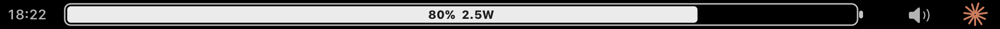
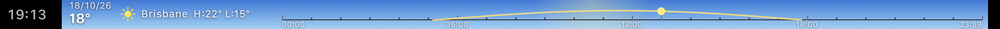
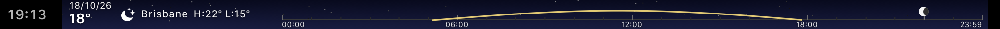

# MatiBar


**A fully custom MacBook Pro Touch Bar, written from scratch in Objective-C.**

MatiBar replaces Apple's Control Strip with your own full-width Touch Bar: a live
animated battery with real-time power draw, a Spotify / Apple Music player with a
draggable timeline, system volume and brightness controls, an animated day & weather
view, a real-time music visualizer, and a one-tap button to open Claude. No third-party
frameworks, no dependencies — just the system APIs that Apple's own Touch Bar uses.

> Built for Apple Silicon MacBook Pro (13"/15"/16") with a Touch Bar, on modern macOS.
> MTMR and the other old tools don't work on current macOS anymore — this one does,
> because it talks to the Touch Bar APIs that are still alive today.

---

## Default view — battery



- **Live animated battery.** The fill colour and animation tell you the state at a glance:
  - 🟢 **Green + forward sweep** — charging
  - ⚪ **White + reverse sweep** — on battery (draining)
  - 🟡 **Yellow** — Low Power Mode
  - 🔴 **Red** — battery below 20%
- **Real-time power draw in watts**, read from the SoC via `IOReport` (works plugged in
  or on battery, even at the 80% charge limit). The drain animation speeds up the more
  power you use.
- The colour turns green the instant you plug in — in sync with the charging chime.

## Audio view — tap the speaker button


- **Album art + track / artist**, pulled live from Spotify or Apple Music. Tap it to
  bring the player window to the front.
- **Thin draggable timeline** — scrub to any point in the song with your finger.
- **Play / pause / previous / next.**
- **10-bar volume** controlling the **system master volume** — tap a bar, drag across
  them, or use the speaker − / + buttons.

## Brightness view — tap the sun button inside audio


- **10-bar display brightness** (`DisplayServices`) — tap, drag, or use the sun − / +
  buttons. A safety floor keeps the screen from going fully black by accident.

## Day & weather view — tap the clock





- **Full-day timeline** (00:00 → 23:59) with hourly tick marks and the **sun's arc drawn
  across the daylight hours**. A marker rides the arc at the current time — a **sun** by
  day, a **real-phase moon** by night (hemisphere-aware).
- **The moon's own path** across the night is drawn as a dashed blue-grey arc.
- **Animated background that matches the real conditions and time of day** — clear blue
  day, starry night, drifting clouds, falling rain, snow, fog, and storms with lightning.
- **Rain icons** over upcoming hours with a high chance of rain.
- Current **temperature, condition, date, and the day's high / low**, from the free
  [Open-Meteo](https://open-meteo.com) API. Location is **precise** if you allow Location
  Services, otherwise approximate (IP-based) — no API key, works anywhere.

## 🔥 The visualizer — hold ⏯ for one second

**The Touch Bar's best-kept secret.** Hold play / pause and the whole bar turns into a
field of square pixels that reacts to **whatever your Mac is playing** — Spotify, YouTube
in a browser, a game, anything — rendered at a locked 30 fps on a pure black background,
with a thermal colour scale that runs from deep navy and violet through red and orange to
yellow and white-hot. Hold ⏯ again to leave; **hold the pixels** to switch between the two
styles (your choice is remembered).

**Horizontal** (default) — a frequency map you can read. Every pixel owns one fixed
frequency, laid out like lines of text: bass at the bottom-left, highs at the top-right.
A pixel flashes white-hot the instant its frequency hits and goes dark the moment it stops,
so every kick, snare, vocal and hi-hat lands in its own exact spot — play the same sound
twice and you get the same picture.


**Mirror** — a thermal spectrum. Bass in the centre, highs out to the edges, growing taller
from the middle row with the volume. Quiet sounds glow cool violet; every hit heats its
column up to yellow and white, and the tips of each bar stay cooler than its core.


What makes it different:

- **It's deterministic.** No random sparkles or fake motion — every pixel is driven by the
  real spectrum, so patterns in the music become patterns on the bar. Silence is black.
- **It holds notes.** A sound that keeps ringing keeps its pixels lit for as long as it
  lasts (louder notes burn hotter), then they let go the instant it stops.
- **It's balanced.** The horizontal map gives every pixel a similar slice of the spectrum
  (linear up to ~3.9 kHz, logarithmic above), so a sustained note draws its harmonics as an
  evenly spaced comb instead of a smear.
- **It's light.** A private Core Audio process tap feeds an Accelerate FFT and a tiny
  software rasterizer — about 6–10% of one core, and the tap exists only while the
  visualizer is open.
- **It's private.** System audio only (never the microphone), analysed in memory, never
  recorded. Works with virtual outputs such as Background Music. Needs macOS 14.2+.

## Long-press shortcuts (hold for one second)

| Hold… | Does |
|-------|------|
| 🔊 **Speaker** | Mute / unmute the system (the icon shows it). Changing the volume unmutes. |
| **Album art / song** | Loop the current song. Skipping or a new song ends the loop. |
| ⏯ **Play / pause** | Open / close the visualizer. |
| **Visualizer pixels** | Switch visualizer style (horizontal ↔ mirror). |
| ☀ **Sun** | **Blackout**: screen and keyboard backlight off, only ☀ 🔊 ✳ stay on the bar. Tap ☀ to come back. |
| **Clock** | Open Calendar. |
| **Weather view** | Open the Weather app. |
| ✳ **Claude** | Start a new Claude chat. |

### Blackout safety

Blackout turns the display all the way down, so MatiBar never trusts itself alone with
it. Before going dark it saves your brightness and keyboard settings to a marker file,
and a separate **guard process** (its own LaunchAgent) watches that file. If MatiBar
crashes, is killed, or stops responding for 12 seconds while the screen is black, the
guard restores your brightness and keyboard backlight (and, if MatiBar is gone, gives you
Apple's Touch Bar back).
If the Mac restarts mid-blackout, MatiBar restores everything as it launches.

---

## Customise

```bash
# visualizer style: horizontal (default) or mirror ("espejo")
defaults write com.mati.matibar visualizer espejo

# song-loop indicator: 1 frame + arrows, 2 orbiting dot, 3 corner brackets,
# 4 badge (always red), 5 two chasing dots + repeat glyph
defaults write com.mati.matibar loopStyle -int 5
defaults write com.mati.matibar loopColor red     # or white
```

MatiBar reads these when it starts — run `launchctl kickstart -k gui/$(id -u)/com.mati.matibar`
to apply them right away (switching the visualizer style by holding the pixels needs no
restart).

## Install

### With Homebrew (recommended)

```bash
brew install roccodedog/tap/matibar
brew services start matibar
```

That's it: MatiBar is built from source on your Mac (no Gatekeeper warnings), takes over
the full Touch Bar, and starts at every login. `brew services stop matibar` — or
`brew uninstall matibar` — gives you Apple's normal Touch Bar back.

### From source

Requires **Xcode Command Line Tools** (`xcode-select --install`).

```bash
git clone https://github.com/RoccoDeDog/MatiBar.git
cd MatiBar
./install.sh
```

This builds `MatiBar.app`, installs it to `/Applications`, switches the Touch Bar to
full-width mode, and sets MatiBar (and its blackout guard) to launch at login.
Use one method or the other, not both.

macOS asks for a few permissions the first time each feature is used — all optional:

- **Automation** (Spotify / Music) — for the player controls. Approve it so playback works.
- **Location** — precise weather. Without it, weather uses your approximate IP location.
- **System Audio Recording Only** — for the visualizer (macOS 14.2 or later).

**Tip for developers:** macOS remembers permissions per code signature. `build.sh` signs
ad-hoc by default, which changes on every build, so macOS asks again after each rebuild.
To keep your permissions across rebuilds, create a self-signed code-signing certificate
named **MatiBar Dev Signing** (Keychain Access → Certificate Assistant → Create a
Certificate → type *Code Signing*), or point `MATIBAR_SIGN_IDENTITY` at any signing
identity you have — `build.sh` picks it up automatically.

**Uninstall** a source install (restores the normal Apple Touch Bar):

```bash
./uninstall.sh
```

For quick dev runs without installing: `./start.sh` and `./stop.sh`.

---

## How it works

MatiBar presents a **system-modal Touch Bar** across the whole bar using the private
`DFRFoundation` framework (`DFRElementSetControlStripPresenceForIdentifier`,
`presentSystemModalTouchBar:placement:…`) — the same mechanism Apple's Control Strip
uses. On top of that:

- **Battery / charging** — `IOKit` (`IOPowerSources`, `AppleSmartBattery`) + a power-source
  change notification for instant updates.
- **Live power (watts)** — `IOReport` "Energy Model" channels (CPU + GPU + ANE + DRAM).
- **Brightness** — `DisplayServices`; keyboard backlight — `CoreBrightness`.
- **Media** — AppleScript to Spotify / Apple Music for metadata, scrubbing, transport and
  looping. Mute and volume through Core Audio.
- **Weather** — Open-Meteo (forecast + hourly rain), Core Location (or IP) for position;
  the sky, timeline, sun and moon are all drawn from scratch.
- **Visualizer** — a private Core Audio **process tap** on the system output (no
  microphone), analysed with an Accelerate FFT and drawn by a small software rasterizer
  into a layer at 30 fps. The tap exists only while the visualizer is open.
- **Long-press** — Touch Bar views don't get mouse events, so every shortcut is a
  direct-touch `NSPressGestureRecognizer`.

Everything is one file: [`matibar.m`](matibar.m). The [`examples/`](examples) folder has a
minimal "hello world" Touch Bar button and a demo that plays looping video on the bar.

See [GUIDE.md](GUIDE.md) for the full user guide (in Spanish).

---

## Security & privacy

- **No account, no server, no telemetry.** MatiBar collects nothing and sends nothing
  about you anywhere.
- **The only network requests are for the weather view:** the forecast from
  [Open-Meteo](https://open-meteo.com), your approximate location from
  [ipapi.co](https://ipapi.co) when precise location isn't allowed, and the city name
  from Apple's geocoder when it is. Nothing else goes online.
- **Audio never leaves your Mac and is never recorded.** The visualizer analyses the
  sound in memory while it's open and keeps nothing.
- **Permissions stay on your Mac** and macOS shows you every prompt.
- **Open source** — every line is in this repo for you to read before you run it.

---

## Notes

- Apple restricted the system "Now Playing" info (`MediaRemote`) for unsigned apps on
  recent macOS, so rich metadata (art / title / scrubber) works for **Spotify and Apple
  Music**; browser audio (YouTube, etc.) can't be read — but the visualizer still reacts
  to it.
- Full-width mode hides Apple's Control Strip while MatiBar runs. `uninstall.sh` puts it
  back.
- Works with virtual audio devices such as Background Music as the default output.

## License

MIT — see [LICENSE](LICENSE).

---

*Designed and built collaboratively with [Claude Code](https://claude.com/claude-code).*
